# 基于uniapp智能小程序商城--论文pf

> 🎓 **计算机毕业设计 · 基于uniapp智能小程序商城--论文pf**
>
> 本仓库只放**项目介绍 + 运行截图**（截图是站点带水印的原图，存在仓库 `images/` 里）。
>
> 👉 **完整可运行源码 / 数据库脚本 / 部署文档：[点我获取](https://geekcode.top/archives/%E5%9F%BA%E4%BA%8Euniapp%E6%99%BA%E8%83%BD%E5%B0%8F%E7%A8%8B%E5%BA%8F%E5%95%86%E5%9F%8E-%E8%AE%BA%E6%96%87pf?utm_source=github)**
>
> 💬 咨询微信：**ir9372**　|　🌐 更多项目：[极客代码 geekcode.top](https://geekcode.top/?utm_source=github)
>
> 📌 项目详情页：<https://geekcode.top/archives/%E5%9F%BA%E4%BA%8Euniapp%E6%99%BA%E8%83%BD%E5%B0%8F%E7%A8%8B%E5%BA%8F%E5%95%86%E5%9F%8E-%E8%AE%BA%E6%96%87pf?utm_source=github>

<table><td width="230" align="center"> <b>扫码加微信 ir9372</b></td><td valign="middle">📦 源码 = 项目介绍 + 全部运行截图 + 数据库 + 部署文档 👉 点上方任意截图，直接跳到 <b>极客代码 geekcode.top</b> 详情页</td></table>

---

<h1>基于uniapp智能小程序商城--论文pf</h1>
<h2>项目概述</h2>

本项目名为“基于uniapp智能小程序商城”，旨在构建一个集商品展示、在线交易、用户互动及管理后台于一体的电子商务系统。项目核心功能涵盖商家入驻、商品管理、购物车结算、订单处理、在线客服及论坛交流等模块，适用于中小规模电商运营场景。技术架构采用前后端分离模式：前端使用 Uni-app 框架开发微信小程序，后端基于 Java Spring Boot 框架构建 RESTful API 服务，数据持久层采用 MyBatis-Plus，安全控制引入 Apache Shiro。系统通过 Web 后台进行全局配置与业务管理，小程序端面向终端用户提供便捷的移动端购物体验，实现了从用户注册登录到商品购买评价的全流程闭环。

<h2>技术架构</h2>

本系统采用典型的前后端分离架构设计，确保系统的可扩展性与维护性。

<strong>1. 前端架构（微信小程序）</strong>
前端应用基于 Uni-app 框架开发，最终编译为微信小程序运行环境。Uni-app 允许开发者使用 Vue.js 语法编写代码，实现一套代码多端发布的能力。在该项目中，主要聚焦于微信小程序端的渲染与交互。前端通过 HTTP 协议调用后端提供的 RESTful API 接口获取数据，利用 <code>wx.request</code> 或封装后的请求库进行网络通信。页面路由由 <code>pages.json</code> 定义，组件化开发提高了界面复用率。

<strong>2. 后端架构（Java Server）</strong>
后端服务基于 Spring Boot 框架构建，利用其自动配置特性快速搭建应用骨架。

<ul>
<li><strong>Web 层</strong>：使用 <code>spring-boot-starter-web</code> 提供 REST 接口支持，控制器（Controller）负责接收前端请求并返回 JSON 格式数据。</li>
<li><strong>安全层</strong>：集成 Apache Shiro (<code>shiro-spring</code>) 实现身份认证与权限授权，保护后台管理接口及部分敏感数据访问。</li>
<li><strong>持久层</strong>：采用 MyBatis-Plus (<code>mybatis-plus</code>, <code>mybatisplus-spring-boot-starter</code>) 作为 ORM 框架，简化了 CRUD 操作，并通过 <code>mysql-connector-java</code> 连接 MySQL 数据库。</li>
<li><strong>模板引擎</strong>：虽然主要为 API 服务，但引入了 <code>spring-boot-starter-thymeleaf</code>，可能用于后台部分静态资源渲染或错误页面展示。</li>
</ul>

<strong>3. 数据库设计要点</strong>
数据库选用 MySQL，存储用户信息、商家资料、商品详情、订单记录、聊天记录及字典表等数据。MyBatis-Plus 提供了通用的 Mapper 接口，减少了 XML 映射文件的编写工作量。针对字典类数据（如性别、状态、分类等），设计了独立的字典表结构（如 <code>dictionarySex</code>, <code>dictionaryShangxia</code> 等），便于统一管理和动态配置。

<strong>4. 交互方式</strong>
小程序前端与 Java 后端通过标准的 REST API 进行交互。前端发送 GET/POST/PUT/DELETE 请求至后端特定路径（如 <code>/api/shangpin/list</code>），后端处理后返回包含状态码和数据体的 JSON 对象。Token 机制用于维持用户会话状态，确保接口调用的安全性。

<a href="https://geekcode.top/archives/%E5%9F%BA%E4%BA%8Euniapp%E6%99%BA%E8%83%BD%E5%B0%8F%E7%A8%8B%E5%BA%8F%E5%95%86%E5%9F%8E-%E8%AE%BA%E6%96%87pf?utm_source=github" title="查看完整源码">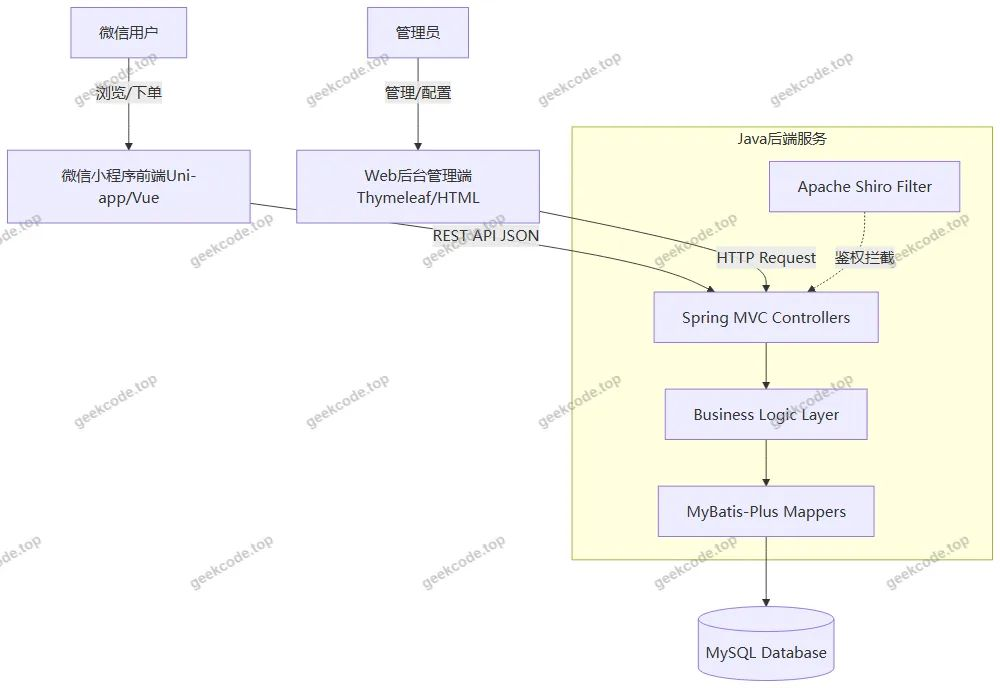</a>

<h2>功能模块</h2>

根据后台路由配置、Controller 列表及小程序截图功能，系统功能划分为以下两大模块：

<h3>1. 小程序用户端功能</h3>

小程序端主要面向普通消费者和入驻商家，提供移动端的购物与管理体验。

<ul>
<li><strong>用户基础模块</strong>：</li>
<li><strong>登录与注册</strong>：支持新用户注册、老用户登录以及忘记密码找回功能。</li>
<li><strong>个人中心</strong>：查看和修改个人信息（<code>userinfo</code>）、修改密码（<code>changepassword</code>）。</li>
<li><strong>账户充值</strong>：支持用户对账户余额进行充值操作。</li>
<li><strong>商品交易模块</strong>：</li>
<li><strong>首页与发现</strong>：展示推荐商品、公告信息及入口导航。</li>
<li><strong>商品浏览</strong>：按分类或关键词搜索商品，查看商品详情页。</li>
<li><strong>商家列表</strong>：浏览平台上的所有入驻商家及其店铺信息。</li>
<li><strong>购物车</strong>：添加商品至购物车，查看购物车列表，进行数量调整或删除。</li>
<li><strong>订单管理</strong>：提交订单确认页（<code>confirm</code>），查看历史商品订单列表，跟踪订单状态。</li>
<li><strong>收货地址</strong>：新增、编辑、删除及选择默认收货地址。</li>
<li><strong>互动与服务模块</strong>：</li>
<li><strong>在线客服</strong>：发起聊天会话，查看在线客服列表及沟通记录。</li>
<li><strong>公告信息</strong>：查看平台发布的最新公告通知。</li>
<li><strong>收藏与评价</strong>：查看个人收藏的商品列表，以及对已购商品进行评价（<code>shangpinCommentback</code>）。</li>
</ul>
<h3>2. Web 后台管理端功能</h3>

后台管理端主要面向超级管理员，用于全平台的业务监控、数据维护及系统配置。

<ul>
<li><strong>系统管理与配置</strong>：</li>
<li><strong>管理员管理</strong>：对后台管理员账号（<code>users</code>）进行增删改查及权限分配。</li>
<li><strong>配置文件</strong>：管理系统全局参数（<code>config</code>），如轮播图设置、网站名称等。</li>
<li><strong>备份还原</strong>：提供数据备份（<code>beifen</code>）与还原（<code>huanyuan</code>）功能，保障数据安全。</li>
<li><strong>文件管理</strong>：上传和管理图片、文档等资源文件（<code>FileController</code>）。</li>
<li><strong>业务数据管理</strong>：</li>
<li><strong>用户管理</strong>：查看和维护小程序注册用户信息（<code>yonghu</code>）。</li>
<li><strong>商家管理</strong>：审核商家入驻申请，管理商家基本信息（<code>shangjia</code>）。</li>
<li><strong>商品管理</strong>：发布新商品，编辑商品信息，上下架管理（<code>shangpin</code>）。</li>
<li><strong>订单管理</strong>：查看所有商品订单（<code>shangpinOrder</code>），处理支付状态（<code>shangpinOrderPayment</code>），管理发货与退款。</li>
<li><strong>购物车监控</strong>：查看用户购物车数据（<code>cart</code>），辅助营销分析。</li>
<li><strong>收藏管理</strong>：查看用户的商品收藏记录（<code>shangpinCollection</code>）。</li>
<li><strong>评论管理</strong>：审核和管理用户对商品的评价内容（<code>shangpinCommentback</code>）。</li>
<li><strong>内容与社区管理</strong>：</li>
<li><strong>公告管理</strong>：发布、编辑和删除平台公告（<code>news</code>）。</li>
<li><strong>论坛管理</strong>：维护社区帖子，管理论坛状态（<code>forum</code>, <code>dictionaryForumState</code>）。</li>
<li><strong>聊天管理</strong>：监控在线客服的聊天记录（<code>chat</code>）。</li>
<li><strong>字典数据维护</strong>：</li>
<li>系统内置多种字典类型供后台维护，包括：性别（<code>dictionarySex</code>）、商家类型（<code>dictionaryShangjia</code>）、商品分类（<code>dictionaryShangpin</code>）、上下架状态（<code>dictionaryShangxia</code>）、订单状态（<code>dictionaryZhuangtai</code>）、是否默认（<code>dictionaryIsdefault</code>）等。这些字典项决定了前端下拉框选项及业务逻辑判断依据。</li>
</ul>
<h2>用户角色与权限</h2>

系统主要涉及两类用户角色，各自拥有不同的权限范围和操作入口。

<strong>1. 小程序用户（C端）</strong>

<ul>
<li><strong>普通消费者</strong>：</li>
<li><strong>权限范围</strong>：仅限访问小程序前端页面。</li>
<li><strong>可执行操作</strong>：注册/登录、浏览商品、加入购物车、创建订单、支付（依赖账户余额或外部支付接口）、评价商品、收藏商品、咨询客服、管理个人收货地址、查看公告。</li>
<li><strong>限制</strong>：无法进入 Web 后台，无权修改其他用户数据，无权发布商品或管理商家信息。</li>
<li><strong>入驻商家（若通过小程序端登录，通常需特殊标识或跳转至专用界面，但在当前上下文主要体现为后台管理的数据实体）</strong>：</li>
<li>注：根据现有路由和截图，商家主要作为被管理对象存在于后台数据库中。若小程序端有独立商家工作台，则具备上架商品、查看本店订单、回复评论等权限。基于当前提供的“无前台导航”且截图仅显示通用用户功能，推测商家主要通过后台或特定接口参与，此处重点描述消费者权限。</li>
</ul>

<strong>2. Web 后台管理员（B端/G端）</strong>

<ul>
<li><strong>超级管理员 (Admin)</strong>：</li>
<li><strong>权限范围</strong>：拥有系统最高权限，通过 Web 浏览器访问后台管理界面。</li>
<li><strong>可执行操作</strong>：</li>
<li><strong>全量数据CRUD</strong>：对所有业务表（用户、商家、商品、订单、评论、聊天等）进行增加、删除、修改、查询。</li>
<li><strong>系统配置</strong>：修改系统参数、管理管理员账号、执行数据备份与还原。</li>
<li><strong>内容审核</strong>：发布公告、管理论坛帖子、审核商品评论。</li>
<li><strong>字典维护</strong>：更新各类基础数据字典，影响前端展示选项。</li>
<li><strong>限制</strong>：通常不直接参与消费行为，专注于管理与监控。</li>
</ul>

<strong>权限控制机制</strong>：
后端使用 Apache Shiro 进行权限校验。未登录用户无法访问受保护的 API 接口；普通用户 Token 仅能访问与其 ID 绑定的个人数据（如自己的订单、地址）；管理员 Session/Token 拥有全局数据访问权限。

<h2>项目特色与创新点</h2>
<ol>
<li>
<strong>跨端兼容性与高效开发</strong>：
   采用 Uni-app 框架开发前端，不仅满足了微信小程序的需求，还保留了向 H5、App 等其他平台迁移的潜力。结合 Vue.js 的响应式特性，提升了前端页面的交互流畅度和开发效率。

</li>
<li>
<strong>完善的字典驱动型架构</strong>：
   系统中大量使用了自定义字典表（如 <code>dictionaryChat</code>, <code>dictionaryNews</code>, <code>dictionaryShangjia</code> 等）。这种设计将业务枚举值（如订单状态、商品类别、性别等）从硬编码中解耦，存储在数据库中。管理员可在后台灵活调整字典项，无需重新部署代码即可改变前端下拉菜单选项或业务规则，极大地增强了系统的可配置性和灵活性。

</li>
<li>
<strong>一体化安全管理体系</strong>：
   集成 Apache Shiro 框架，实现了细粒度的权限控制和会话管理。针对后台管理的高敏感性，提供了专门的管理员登录隔离；针对小程序端，采用了基于 Token 的身份验证机制，保障了用户隐私数据（如收货地址、订单信息）的安全访问。

</li>
<li>
<strong>丰富的社交与互动元素</strong>：
   除了基础的电商交易功能，项目还集成了在线客服（<code>chat</code>）和论坛社区（<code>forum</code>）模块。这使得商城不仅仅是一个交易平台，更成为一个具备用户粘性、促进商家与消费者、消费者与消费者之间互动的社区型电商平台，有助于提升用户留存率和品牌忠诚度。

</li>
<li>
<strong>健壮的数据运维能力</strong>：
   后台特有的一键备份（<code>beifen</code>）与还原（<code>huanyuan</code>）功能，体现了对生产环境数据安全的重视。对于毕业设计或中小型商用项目而言，内置的数据容灾方案显著降低了因误操作或系统故障导致数据丢失的风险。

</li>
</ol>
<h2>部署环境</h2>

为确保项目正常运行，需准备以下软硬件环境：

<strong>1. 硬件要求</strong>

<ul>
<li>CPU: Intel Core i5 及以上或同等性能处理器。</li>
<li>内存: 建议 8GB RAM 及以上（开发机），服务器建议 4GB+。</li>
<li>硬盘: 至少 50GB 可用空间。</li>
</ul>

<strong>2. 软件环境</strong>

<ul>
<li><strong>JDK</strong>: Java Development Kit 1.8 或以上版本（推荐 JDK 8，以兼容 Spring Boot 常见稳定版本）。</li>
<li><strong>Maven</strong>: 3.6.x 或以上版本，用于后端项目的依赖管理和打包。</li>
<li><strong>MySQL</strong>: 5.7.x 或 8.0.x 版本，需初始化项目所需的数据库脚本。</li>
<li><strong>Node.js</strong>: 12.x - 16.x 版本（LTS 推荐），用于安装 Uni-app 相关 CLI 工具及 npm 包。</li>
<li><strong>HBuilderX</strong>: DCloud 官方 IDE，用于 Uni-app 项目的开发与编译。</li>
<li><strong>微信开发者工具</strong>: 最新版，用于预览、调试和发布微信小程序。</li>
<li><strong>IDE</strong>: IntelliJ IDEA 或 Eclipse，用于 Java 后端代码的开发与维护。</li>
<li><strong>浏览器</strong>: Chrome, Edge, Firefox 等现代浏览器，用于访问 Web 后台管理端。</li>
</ul>

<strong>3. 启动步骤简述</strong>

<ol>
<li>导入 SQL 脚本至 MySQL 数据库。</li>
<li>修改后端 <code>application.yml</code> 中的数据库连接配置。</li>
<li>使用 Maven 命令 <code>mvn clean package</code> 或直接运行主类启动 Spring Boot 后端服务。</li>
<li>在 HBuilderX 中打开小程序源码目录，点击“运行” -&gt; “运行到小程序模拟器” -&gt; “微信开发者工具”。</li>
<li>确保小程序端配置的 API 基础路径指向本地运行的后端服务地址（如 <code>http://localhost:8080/api</code>）。</li>
</ol>
<h2>五、技术特性</h2>
<ul>
<li>前后端集成部署，前端资源打包至后端 static 目录</li>
<li>使用 MyBatis-Plus 简化数据访问层开发</li>
<li>集成 Shiro 权限框架实现角色权限控制</li>
</ul>
<h2>六、功能模块截图</h2>
<h3>微信小程序用户端</h3>

<figure><a href="https://geekcode.top/archives/%E5%9F%BA%E4%BA%8Euniapp%E6%99%BA%E8%83%BD%E5%B0%8F%E7%A8%8B%E5%BA%8F%E5%95%86%E5%9F%8E-%E8%AE%BA%E6%96%87pf?utm_source=github" title="查看完整源码">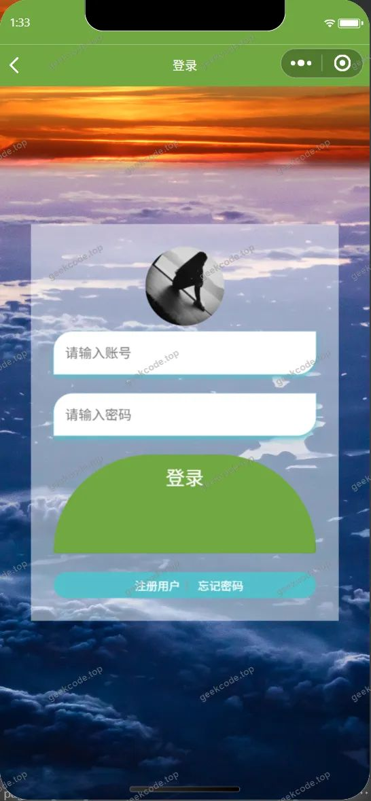</a><figcaption>小程序-登录</figcaption></figure>
<figure><figcaption>小程序-个人信息userinfo</figcaption></figure>
<figure><a href="https://geekcode.top/archives/%E5%9F%BA%E4%BA%8Euniapp%E6%99%BA%E8%83%BD%E5%B0%8F%E7%A8%8B%E5%BA%8F%E5%95%86%E5%9F%8E-%E8%AE%BA%E6%96%87pf?utm_source=github" title="查看完整源码">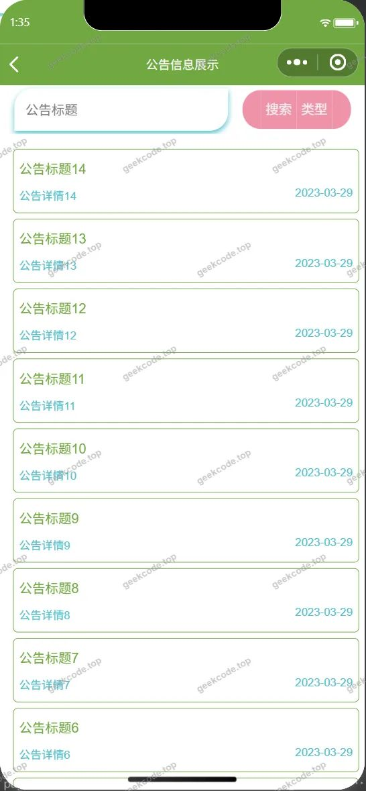</a><figcaption>小程序-公告信息列表</figcaption></figure>
<figure><a href="https://geekcode.top/archives/%E5%9F%BA%E4%BA%8Euniapp%E6%99%BA%E8%83%BD%E5%B0%8F%E7%A8%8B%E5%BA%8F%E5%95%86%E5%9F%8E-%E8%AE%BA%E6%96%87pf?utm_source=github" title="查看完整源码">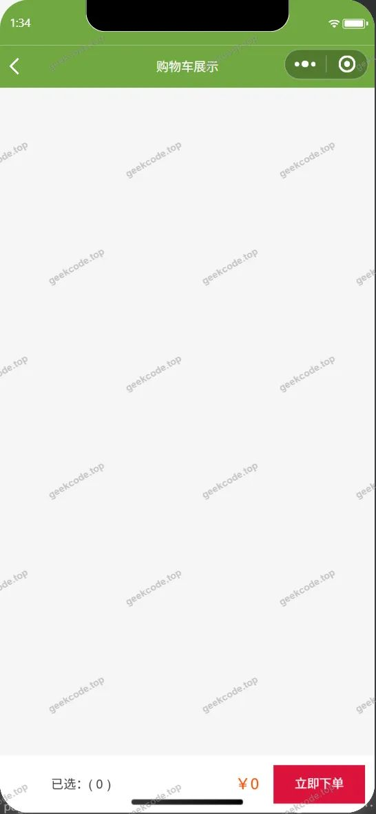</a><figcaption>小程序-购物车列表</figcaption></figure>
<figure><a href="https://geekcode.top/archives/%E5%9F%BA%E4%BA%8Euniapp%E6%99%BA%E8%83%BD%E5%B0%8F%E7%A8%8B%E5%BA%8F%E5%95%86%E5%9F%8E-%E8%AE%BA%E6%96%87pf?utm_source=github" title="查看完整源码">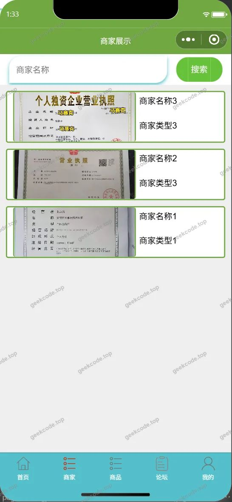</a><figcaption>小程序-商家</figcaption></figure>
<figure><figcaption>小程序-商品</figcaption></figure>
<figure><a href="https://geekcode.top/archives/%E5%9F%BA%E4%BA%8Euniapp%E6%99%BA%E8%83%BD%E5%B0%8F%E7%A8%8B%E5%BA%8F%E5%95%86%E5%9F%8E-%E8%AE%BA%E6%96%87pf?utm_source=github" title="查看完整源码">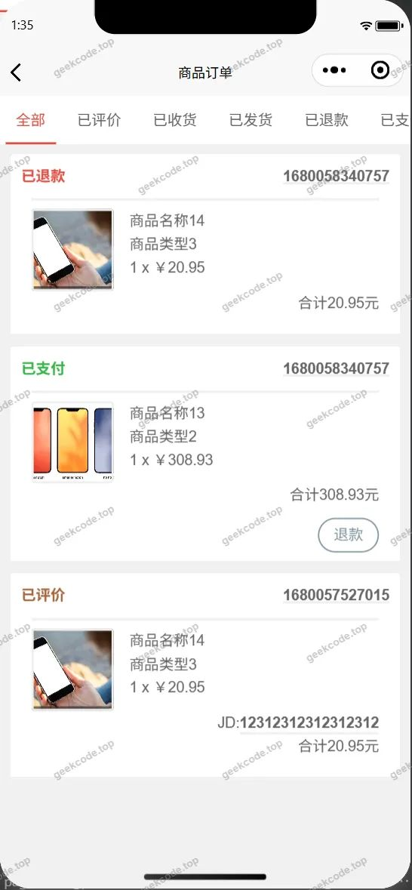</a><figcaption>小程序-商品订单列表</figcaption></figure>
<figure><figcaption>小程序-商品订单confirm</figcaption></figure>
<figure><a href="https://geekcode.top/archives/%E5%9F%BA%E4%BA%8Euniapp%E6%99%BA%E8%83%BD%E5%B0%8F%E7%A8%8B%E5%BA%8F%E5%95%86%E5%9F%8E-%E8%AE%BA%E6%96%87pf?utm_source=github" title="查看完整源码">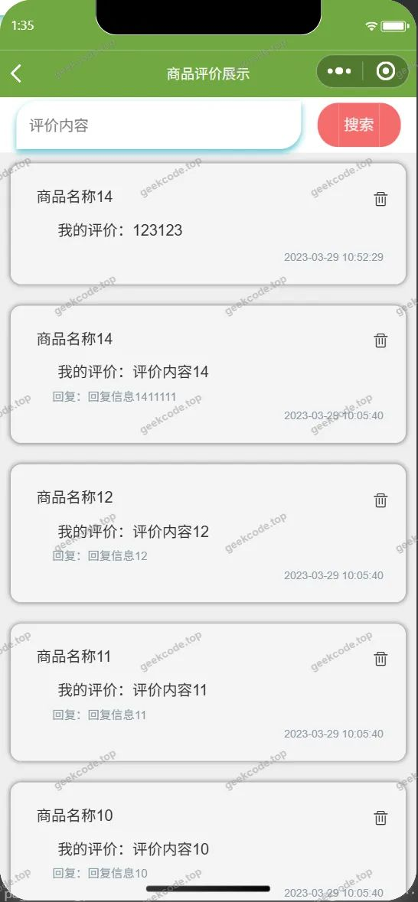</a><figcaption>小程序-商品评价列表</figcaption></figure>
<figure><figcaption>小程序-商品收藏列表</figcaption></figure>
<figure><a href="https://geekcode.top/archives/%E5%9F%BA%E4%BA%8Euniapp%E6%99%BA%E8%83%BD%E5%B0%8F%E7%A8%8B%E5%BA%8F%E5%95%86%E5%9F%8E-%E8%AE%BA%E6%96%87pf?utm_source=github" title="查看完整源码">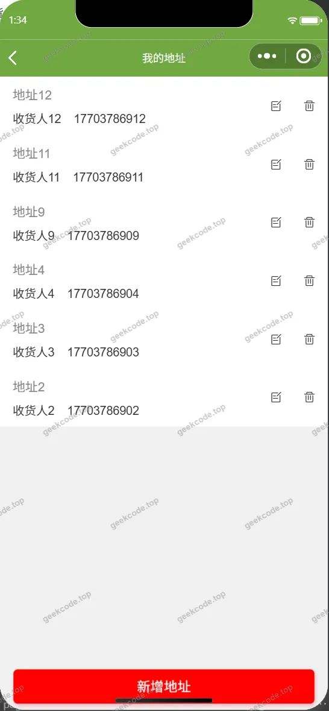</a><figcaption>小程序-收货地址列表</figcaption></figure>
<figure><a href="https://geekcode.top/archives/%E5%9F%BA%E4%BA%8Euniapp%E6%99%BA%E8%83%BD%E5%B0%8F%E7%A8%8B%E5%BA%8F%E5%95%86%E5%9F%8E-%E8%AE%BA%E6%96%87pf?utm_source=github" title="查看完整源码">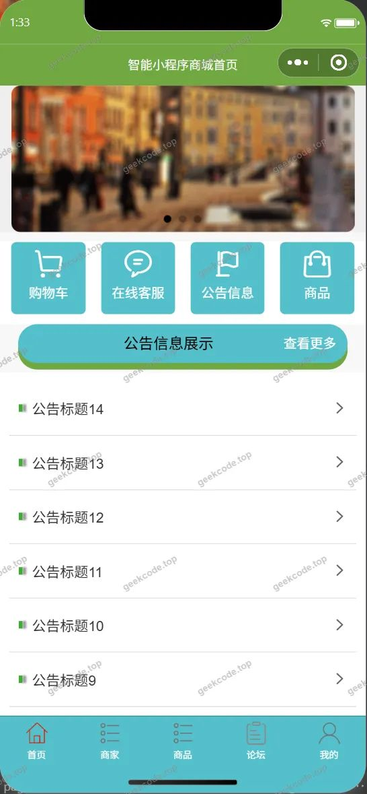</a><figcaption>小程序-首页</figcaption></figure>
<figure><figcaption>小程序-忘记密码</figcaption></figure>
<figure><a href="https://geekcode.top/archives/%E5%9F%BA%E4%BA%8Euniapp%E6%99%BA%E8%83%BD%E5%B0%8F%E7%A8%8B%E5%BA%8F%E5%95%86%E5%9F%8E-%E8%AE%BA%E6%96%87pf?utm_source=github" title="查看完整源码">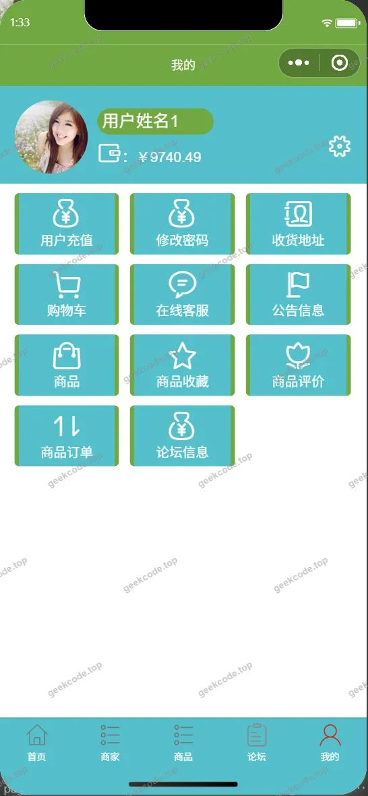</a><figcaption>小程序-我的</figcaption></figure>
<figure><figcaption>小程序-在线客服列表</figcaption></figure>
<figure><figcaption>小程序-账户充值</figcaption></figure>
<figure><figcaption>小程序-注册</figcaption></figure>
<figure><figcaption>小程序-changepassword</figcaption></figure>

<h3>后台管理端</h3>
<h4>后台-登录页</h4>

<h4>后台-公告信息</h4>

<a href="https://geekcode.top/archives/%E5%9F%BA%E4%BA%8Euniapp%E6%99%BA%E8%83%BD%E5%B0%8F%E7%A8%8B%E5%BA%8F%E5%95%86%E5%9F%8E-%E8%AE%BA%E6%96%87pf?utm_source=github" title="查看完整源码">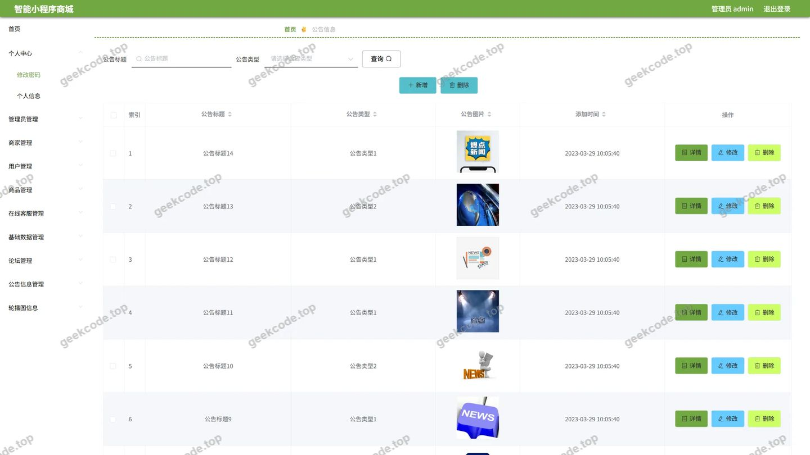</a>

<h4>后台-购物车</h4>

<a href="https://geekcode.top/archives/%E5%9F%BA%E4%BA%8Euniapp%E6%99%BA%E8%83%BD%E5%B0%8F%E7%A8%8B%E5%BA%8F%E5%95%86%E5%9F%8E-%E8%AE%BA%E6%96%87pf?utm_source=github" title="查看完整源码">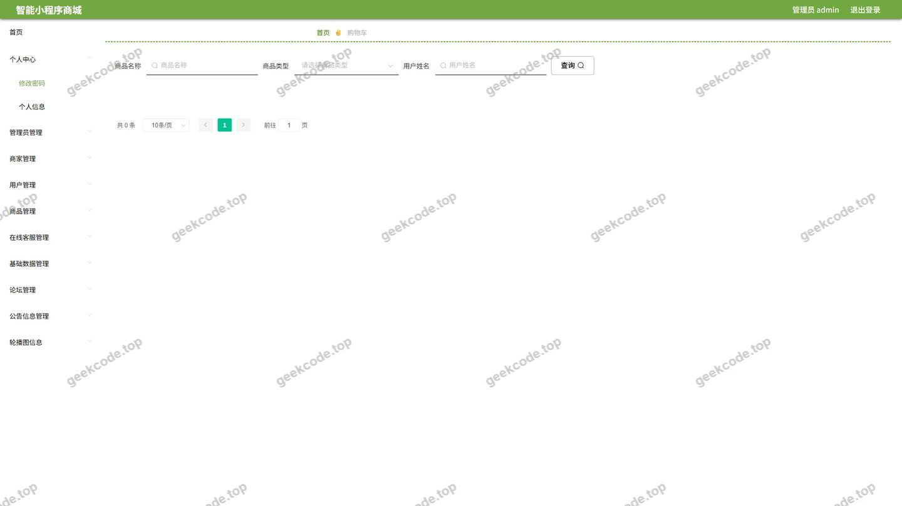</a>

<h4>后台-管理员</h4>

<a href="https://geekcode.top/archives/%E5%9F%BA%E4%BA%8Euniapp%E6%99%BA%E8%83%BD%E5%B0%8F%E7%A8%8B%E5%BA%8F%E5%95%86%E5%9F%8E-%E8%AE%BA%E6%96%87pf?utm_source=github" title="查看完整源码">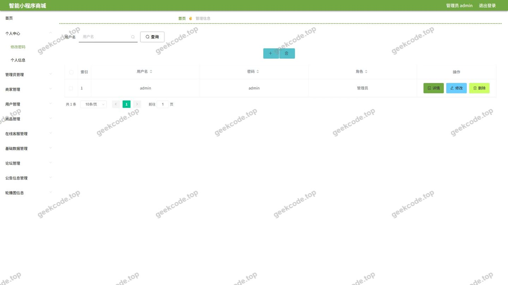</a>

<h4>后台-配置文件</h4>

<a href="https://geekcode.top/archives/%E5%9F%BA%E4%BA%8Euniapp%E6%99%BA%E8%83%BD%E5%B0%8F%E7%A8%8B%E5%BA%8F%E5%95%86%E5%9F%8E-%E8%AE%BA%E6%96%87pf?utm_source=github" title="查看完整源码">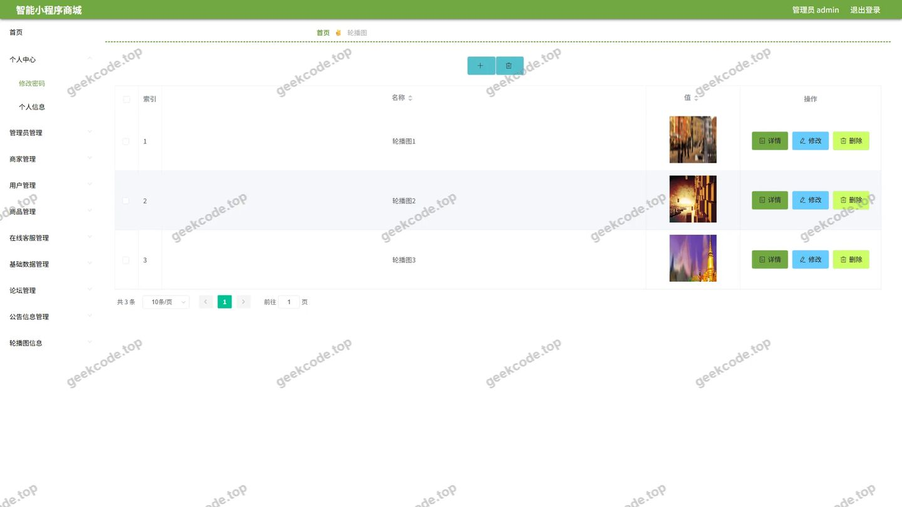</a>

<h4>后台-收货地址</h4>

<a href="https://geekcode.top/archives/%E5%9F%BA%E4%BA%8Euniapp%E6%99%BA%E8%83%BD%E5%B0%8F%E7%A8%8B%E5%BA%8F%E5%95%86%E5%9F%8E-%E8%AE%BA%E6%96%87pf?utm_source=github" title="查看完整源码">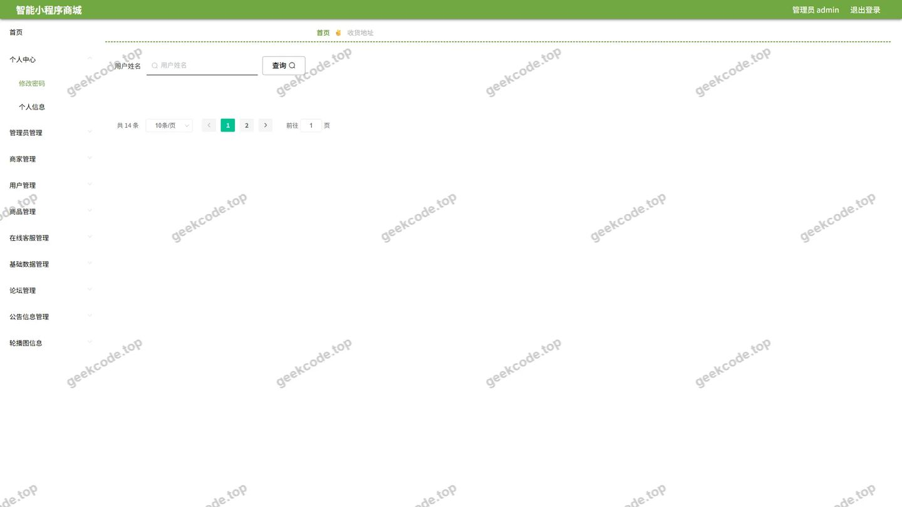</a>

<h4>后台首页</h4>

<a href="https://geekcode.top/archives/%E5%9F%BA%E4%BA%8Euniapp%E6%99%BA%E8%83%BD%E5%B0%8F%E7%A8%8B%E5%BA%8F%E5%95%86%E5%9F%8E-%E8%AE%BA%E6%96%87pf?utm_source=github" title="查看完整源码">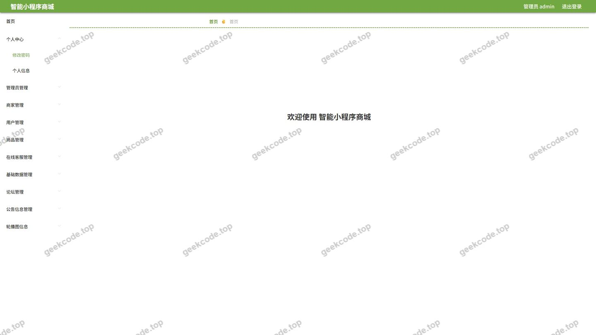</a>

<h4>后台-在线客服</h4>

<a href="https://geekcode.top/archives/%E5%9F%BA%E4%BA%8Euniapp%E6%99%BA%E8%83%BD%E5%B0%8F%E7%A8%8B%E5%BA%8F%E5%95%86%E5%9F%8E-%E8%AE%BA%E6%96%87pf?utm_source=github" title="查看完整源码">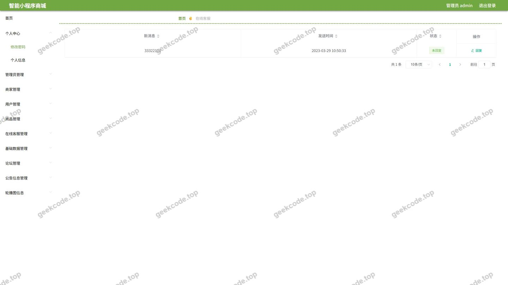</a>

---

## 获取完整源码

| 项目 | 说明 |
| --- | --- |
| 项目名 | 基于uniapp智能小程序商城--论文pf |
| 运行截图 | 本文 27 张（站点带水印原图，仓库 `images/` 目录） |
| 完整源码 | [https://geekcode.top/archives/%E5%9F%BA%E4%BA%8Euniapp%E6%99%BA%E8%83%BD%E5%B0%8F%E7%A8%8B%E5%BA%8F%E5%95%86%E5%9F%8E-%E8%AE%BA%E6%96%87pf?utm_source=github](https://geekcode.top/archives/%E5%9F%BA%E4%BA%8Euniapp%E6%99%BA%E8%83%BD%E5%B0%8F%E7%A8%8B%E5%BA%8F%E5%95%86%E5%9F%8E-%E8%AE%BA%E6%96%87pf?utm_source=github) |
| 咨询微信 | **ir9372**（备注：jingpin-yuanma） |
| 更多项目 | [极客代码 geekcode.top](https://geekcode.top/?utm_source=github) |

> 需要源码、部署、改配置、跑不起来等问题，加微信 ir9372 沟通，说明项目名即可。
